# RoProfit

Loja de Robux com pagamento por Pix, programa de fidelidade (RP Coins), central de ajuda e painel de operação.

Este repositório é uma vitrine do projeto: telas do site e do painel administrativo. O código-fonte não está aqui.

## O que tem no projeto

- **Compra em três passos.** Quantidade, usuário Roblox (conferido antes de pagar) e Pix. O preço aparece logo na primeira tela.
- **Pagamento por Pix.** QR Code e código copia e cola, com confirmação automática e acompanhamento do pedido.
- **RP Coins.** Cada compra rende coins, que podem ser trocadas por Robux ou títulos. As coins valem 15 dias e o vencimento aparece no extrato.
- **Perfil do cliente.** Nível com emblemas 3D, histórico de pedidos com "comprar de novo", contas Roblox salvas, segurança e aparelhos conectados.
- **Central de ajuda.** Busca instantânea, perguntas por assunto e chamados com a equipe.
- **Painel administrativo.** Fila de entrega, vendas, clientes, ciclos, RP Coins, suporte e simulador, com busca rápida (⌘K).

## Telas

### Site

| | |
|---|---|
| 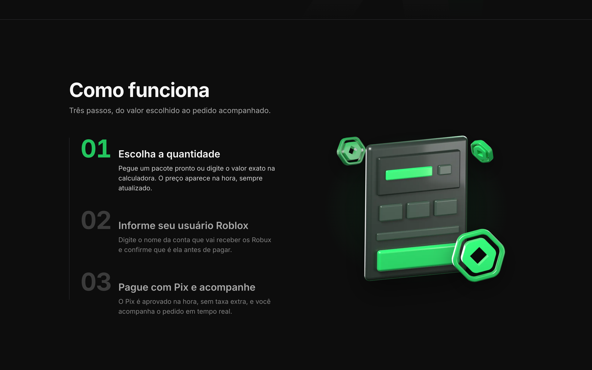 | 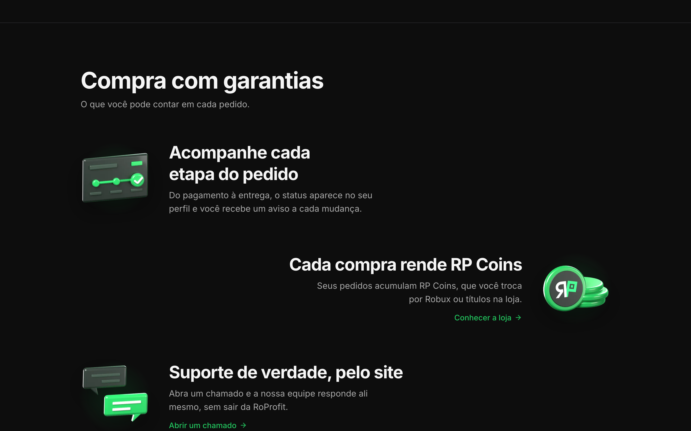 |
| 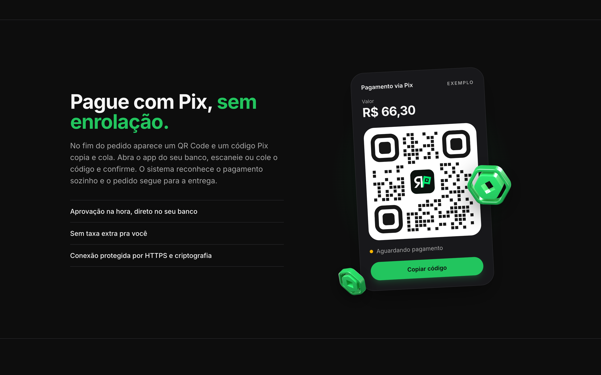 |  |
| 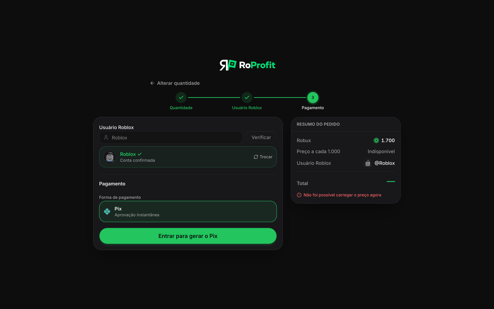 | 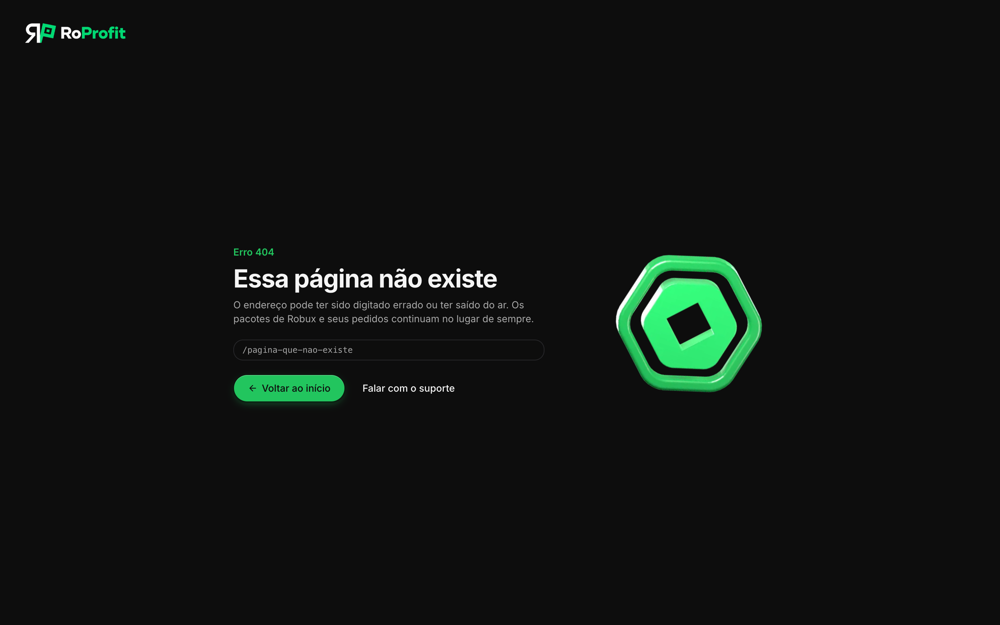 |

### Área do cliente

| | |
|---|---|
| 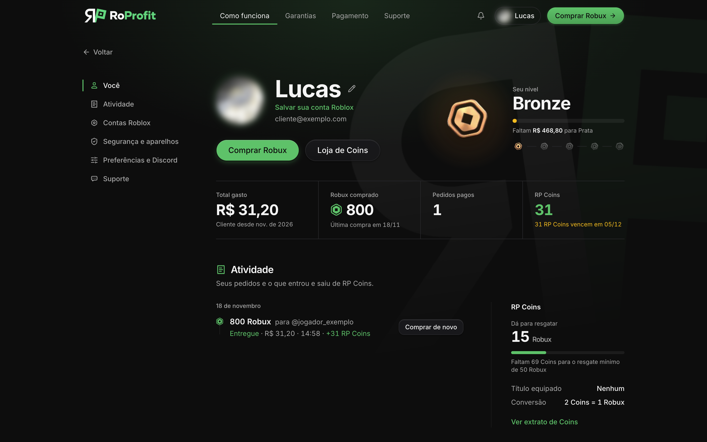 | 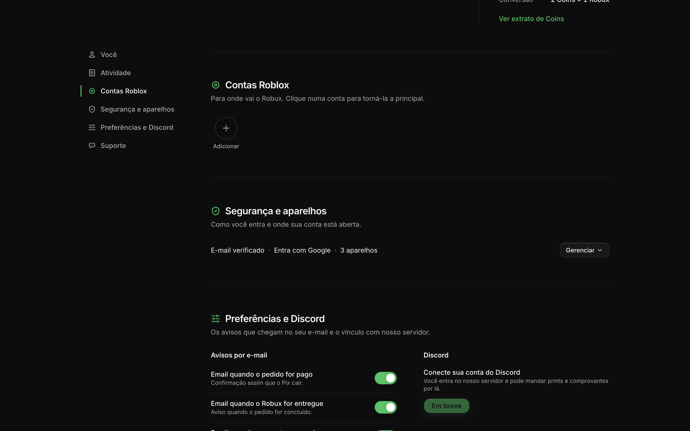 |
| 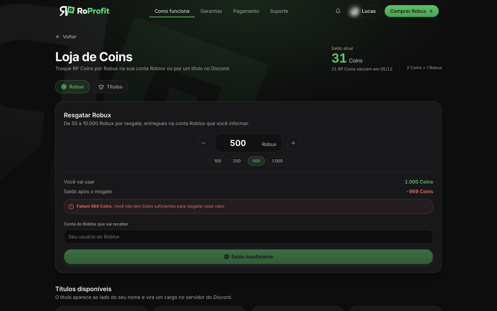 | 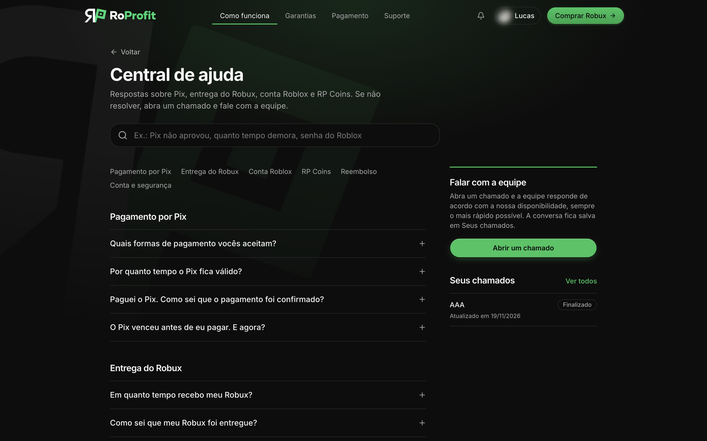 |

### Painel administrativo

| | |
|---|---|
| 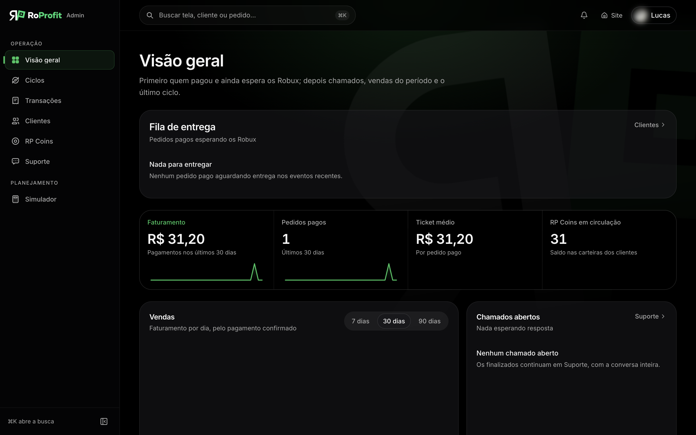 | 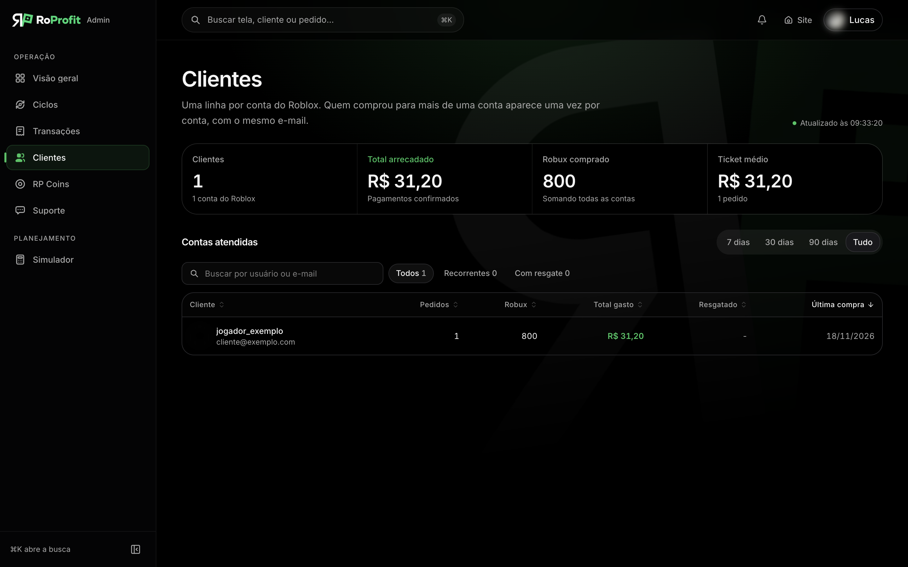 |
| 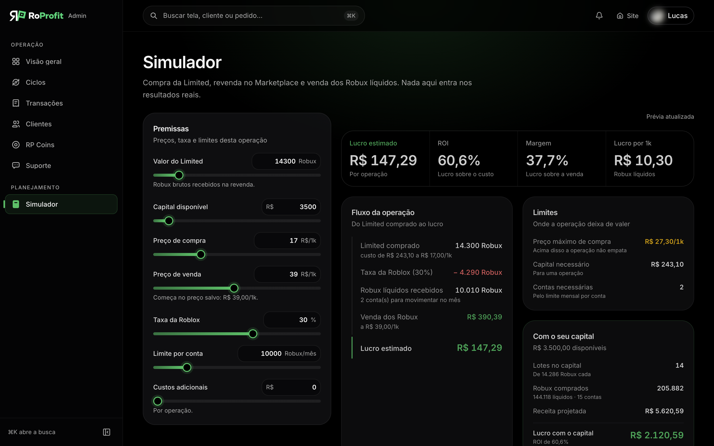 | |

### Celular

| | | | |
|---|---|---|---|
| 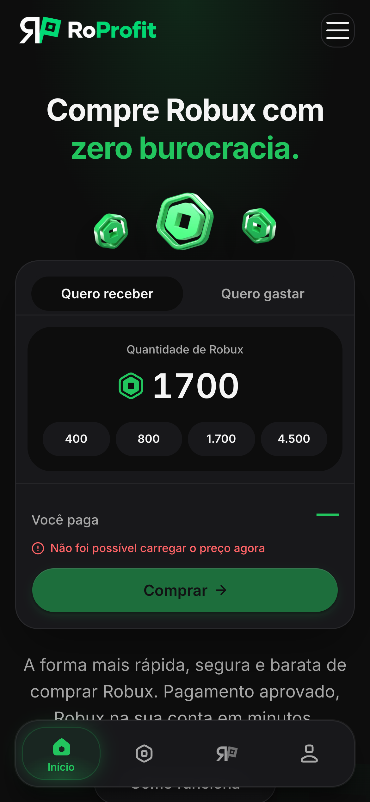 | 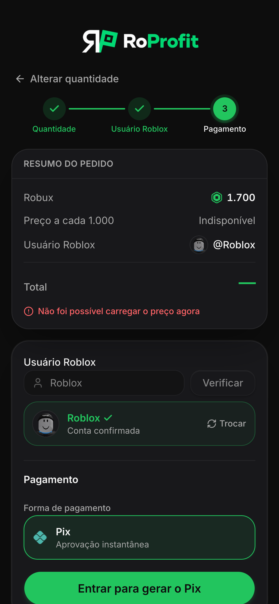 | 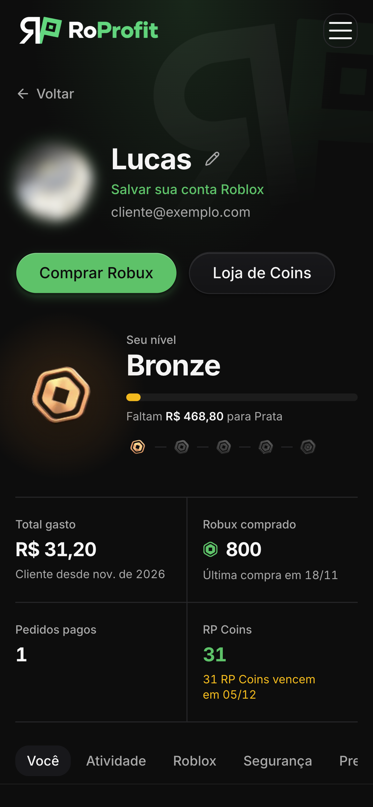 | 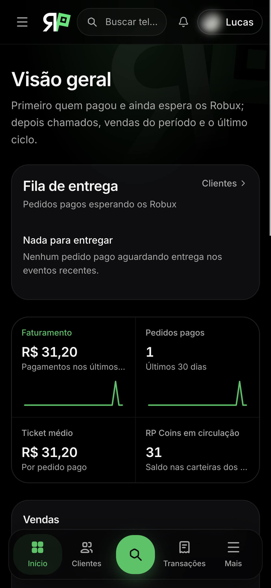 |

Os dados nas telas são de exemplo.
